# Parametric Analysis and Optimization of an Ethanol-Fuelled SI Engine

**Group 11 · ME60111 Internal Combustion Engine · IIT Kharagpur**

ANSYS Chemkin-Pro 2025 R2 · 150-case full-factorial study

This repository preserves the Chemkin project, reaction mechanism, exported data, Python analysis, figures, [final technical report](Group11_Report.docx), and [final presentation](presentations/Group11_Ethanol_Final_v11.pptx). The reported performance quantities are **indicated simulation results**, not measured brake-engine output.

## Contents

- [Objectives and model](#objectives-and-model)
- [Theory and performance quantities](#theory-and-performance-quantities)
- [Method and data flow](#method-and-data-flow)
- [Isolated effects](#isolated-effects)
- [Combustion-parameter interaction](#combustion-parameter-interaction)
- [Best sampled conditions](#best-sampled-conditions)
- [Ideal Otto comparison](#ideal-otto-comparison)
- [Gamma analysis](#gamma-analysis)
- [Reproduce and navigate](#reproduce-and-navigate)
- [Limitations and contributors](#limitations-and-contributors)

## Objectives and model

The [course assignment](<Problem statements for group projects (1).pdf>) asks for the effects of engine speed, combustion start angle, and burn duration; maximum indicated torque and power; minimum indicated specific fuel consumption (ISFC); an ideal Otto-cycle comparison; and interpretation of isolated and interacting effects. The [report](Group11_Report.docx) contains the full discussion and genuine Chemkin screenshots.

The **SI Engine Zonal Simulator** represents burned and unburned zones with detailed chemistry. A **prescribed Wiebe burn profile** imposes combustion progress through the selected start angle and duration; it does not independently predict turbulent flame propagation. The supplied mechanism contains **80 species and 349 reactions**. `mech.dat`, `therm.dat`, and `trans.dat` provide chemistry, thermodynamic, and transport data. Its overall ethanol oxidation balance, distinct from the detailed reaction pathway, is:

$$\mathrm{C_2H_5OH + 3O_2 \rightarrow 2CO_2 + 3H_2O}$$

| Baseline setting | Recorded value or model choice |
| --- | --- |
| Fuel and oxidizer | Ethanol; oxidizer air with 21% O₂ and 79% N₂ by mole |
| Initial mixture mole fractions | Ethanol 0.0335363; O₂ 0.2029574; N₂ 0.7635063 |
| Compression ratio | 12 |
| Bore; stroke | 8.5 cm; 10.82 cm |
| Rod/crank radius ratio | 3.3 |
| Baseline speed | 600 RPM |
| Model | Two active chemistry zones; prescribed combustion |
| Wall heat transfer | Zero in the baseline model |

These settings are recorded in the packaged [Chemkin input](chemkin/project/project.inp). The 600 RPM baseline is separate from the 150 analysed study cases. The [engine-configuration screenshot](screenshots/01_Chemkin_Setup/01_Engine_Geometry_Compression_Ratio.png) and [populated parameter-study screenshot](screenshots/02_Chemkin_Parameter_Study/02_Populated_Parameter_Table.png) show actual project interfaces.

## Theory and performance quantities

**Top dead centre (TDC)** is the position of minimum cylinder volume. Negative crank angles in this study occur before TDC. Moving prescribed heat release relative to compression and expansion changes indicated work. Too-early release can raise compression-side work; very late or prolonged release can contribute less to useful expansion. These are physical interpretations, not separately measured pressure-work decompositions.

| Quantity | Relation | Physical meaning |
| --- | --- | --- |
| Indicated power | $P_i=2\pi NT_i/60$ | Torque $T_i$ (N·m) at speed $N$ (rev/min) gives power $P_i$ (W). |
| Indicated thermal efficiency | $\eta_{th,i}=P_i/(\dot m_f LHV)$ | Fraction of fuel-energy input rate converted into indicated power. |
| ISFC | $ISFC=(\dot m_f/P_i)\,3.6\times10^9$ | Fuel mass per indicated output (g/kWh), for $\dot m_f$ in kg/s and $P_i$ in W. |

These relations explain the exported Chemkin quantities and units. The objective rankings below come directly from the [150-case dataset](Group11_Final_Analysis/data/group11_150_cases.csv). The $P_i$ relation explains why power can rise strongly with RPM while torque changes little in a particular fixed operating slice; it does not establish a universal real-engine torque law.

## Method and data flow

Every speed is paired with every start-angle and duration combination: **6 × 5 × 5 = 150 simulations**. Run #1 in the original workbook is a separate baseline; Run #2 through Run #151 form the analysed grid.

| Parameter | Evaluated levels |
| --- | --- |
| Engine speed | 500, 1000, 1500, 2000, 2500, 3000 RPM |
| Combustion start | −15, −12.5, −10, −7.5, −5°CA |
| Burn duration | 10, 20, 30, 40, 50°CA |


The [analysis script](Group11_Final_Analysis/analyze_group11.py) checks the row count, 150 unique input combinations, positive power and ISFC, and power–torque consistency. Its [quality-check summary](Group11_Final_Analysis/results/quality_checks.json) explicitly marks original solver convergence as unverified. Data consistency does not substitute for a complete per-case solver-log review.

## Isolated effects

Each pair below varies one parameter while holding the other two fixed. These slices establish local trends only.

### Engine speed: −10°CA start, 30°CA duration

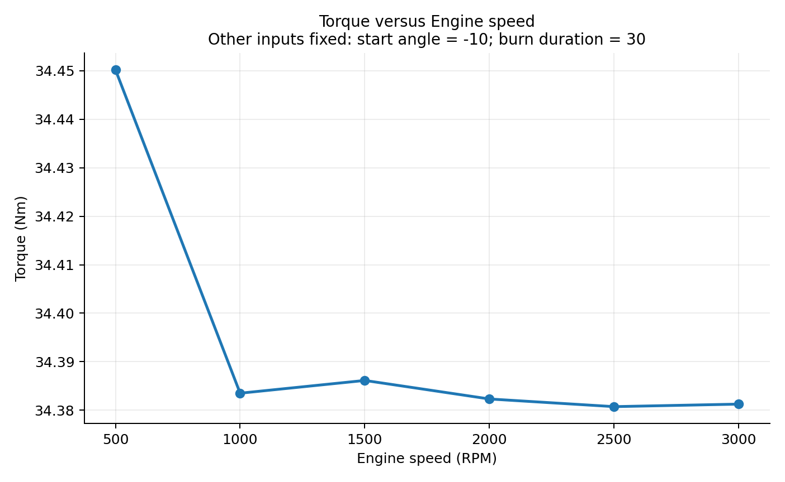

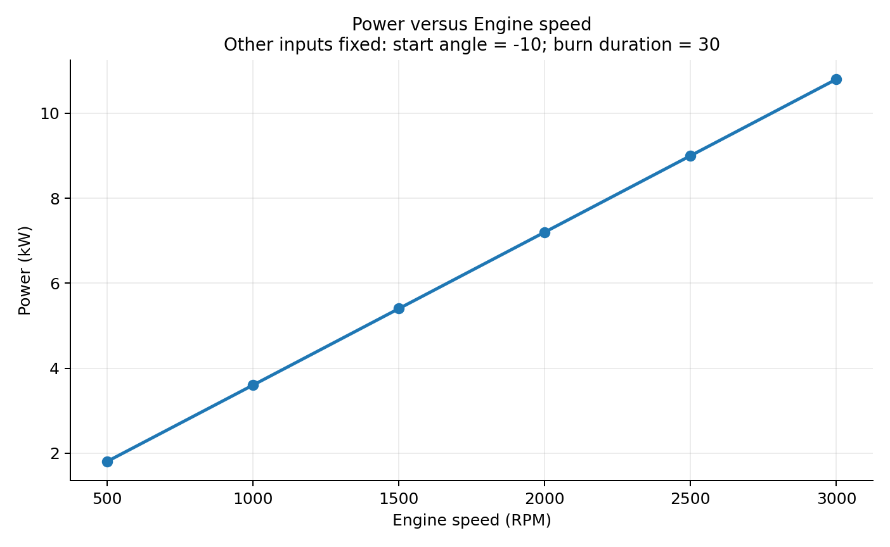

In this model slice, torque changes little over 500–3000 RPM, whereas indicated power rises strongly. With approximately steady $T_i$, the factor $N$ in $P_i=2\pi NT_i/60$ increases the rate of delivered work.

### Combustion start: 1500 RPM, 30°CA duration

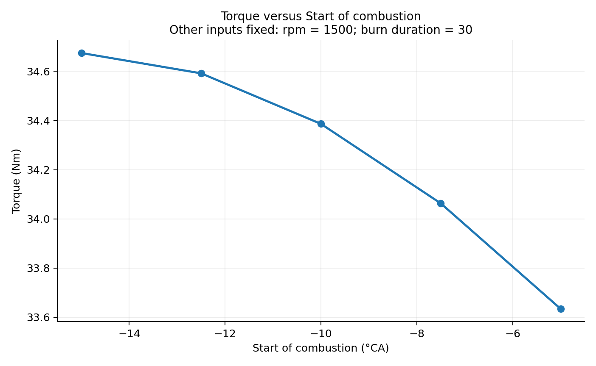

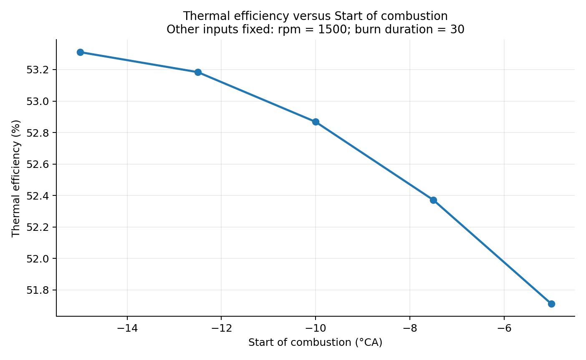

Advancing the start from −5°CA toward −15°CA raises torque and indicated efficiency **in this fixed-duration slice**. For a relatively long prescribed burn, earlier initiation can shift more release toward useful early expansion. The −15°CA local trend does not contradict the full-grid result because the preferred start changes with duration.

### Burn duration: 1500 RPM, −10°CA start

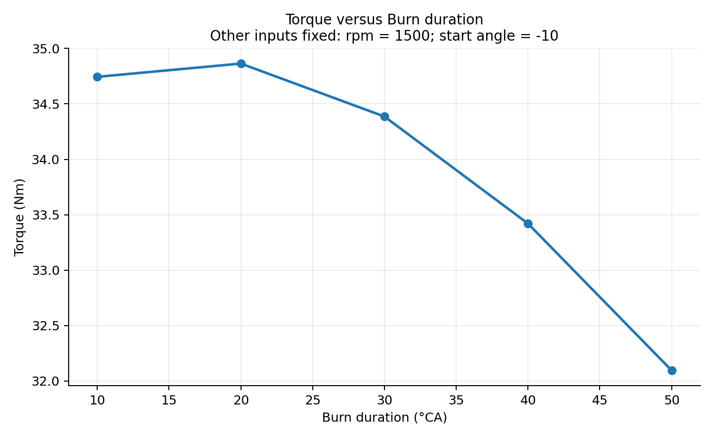

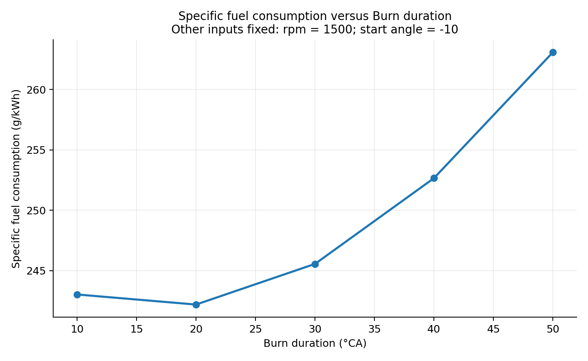

Torque reaches a **local fixed-slice maximum near 20°CA**; ISFC rises after the favourable duration. A longer imposed event shifts more heat release into later expansion, consistent with reduced useful indicated work for this start angle. This is not the overall grid optimum.

## Combustion-parameter interaction

In each figure, the horizontal axis is burn duration and each curve represents a combustion start angle. Changing curve separation and ordering shows that start and duration **interact**. Lines connect discrete simulated points; they do not prove behaviour between sampled settings. The three figures below are the exact images embedded as Figures 9–11 in the final report.

### Torque at 1000 RPM

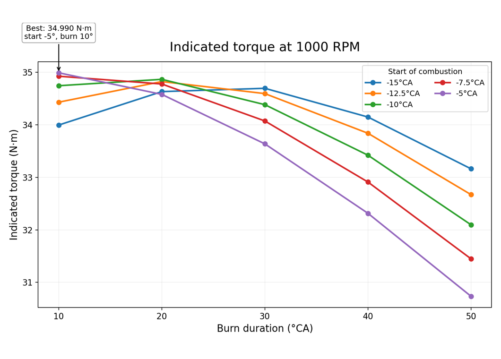

The maximum sampled torque is **34.990 N·m at 1000 RPM, −5°CA start, and 10°CA duration**. At longer durations, a different start can become preferable, so the short-duration timing cannot be selected from a 30°CA fixed slice.

### Power at 3000 RPM

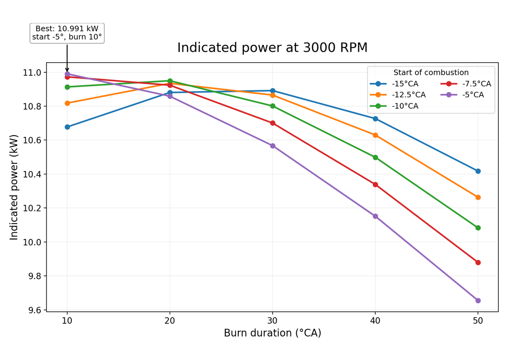

The maximum sampled power is **10.991 kW at 3000 RPM, −5°CA start, and 10°CA duration**. The timing yields strong torque while the highest tested rotational speed raises the delivered work rate.

### ISFC at 1000 RPM

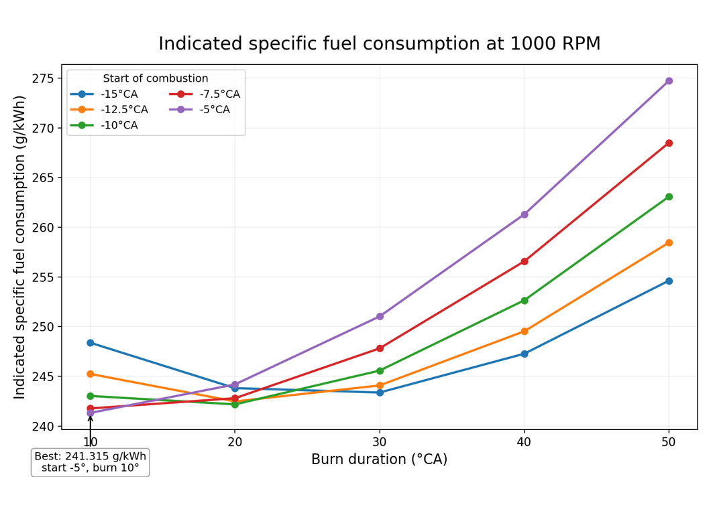

The minimum sampled ISFC is **241.315 g/kWh at 1000 RPM, −5°CA start, and 10°CA duration**. The later-start curve loses its fuel-use advantage as duration grows. Together, these figures explain why the −15°CA trend at a fixed 30°CA duration and the −5°CA + 10°CA complete-grid result can both be correct.

The appendix of the report also contains discrete [torque](Group11_Final_Analysis/plots/heatmap_1000rpm_torque_Nm.png), [power](Group11_Final_Analysis/plots/heatmap_3000rpm_power_kW.png), and [ISFC](Group11_Final_Analysis/plots/heatmap_1000rpm_sfc_g_per_kWh.png) heatmaps. Sampled cells do not define a continuous response surface.

## Best sampled conditions

The [objective table](Group11_Final_Analysis/results/optimal_cases.csv) selects existing rows of the 150-case export:

| Objective | Best sampled result | Speed | Start | Duration |
| --- | ---: | ---: | ---: | ---: |
| Maximum indicated torque | **34.990 N·m** | 1000 RPM | −5°CA | 10°CA |
| Maximum indicated power | **10.991 kW** | 3000 RPM | −5°CA | 10°CA |
| Minimum ISFC | **241.315 g/kWh** | 1000 RPM | −5°CA | 10°CA |
| Maximum indicated thermal efficiency | **53.797%** | 1000 RPM | −5°CA | 10°CA |

A short prescribed 10°CA event beginning at −5°CA concentrates release close to TDC. In the model, its performance is **consistent with** favourable pressure contribution during early expansion. Earlier initiation of such a short event may shift release into compression; a longer event can extend too far into expansion. The study did not separately calculate compression-side work loss for every case.

**Boundary qualification:** −5°CA is the latest tested start and 10°CA is the shortest tested duration. The true continuous optimum may lie outside these boundaries. These values are only the **best sampled condition within the evaluated grid**. Future work should extend the feasible timing range where physically and model-wise appropriate, then make a finer local sweep.

## Ideal Otto comparison

The ideal air-standard Otto cycle has isentropic compression, instantaneous constant-volume heat addition, isentropic expansion, and constant-volume heat rejection. For compression ratio $r=12$ and **assumed constant ideal-air $\gamma=1.4$**:

$$\eta_{\mathrm{Otto}}=1-\frac{1}{r^{\gamma-1}}=1-\frac{1}{12^{0.4}}\approx62.99\%$$

| Quantity | Value |
| --- | ---: |
| Ideal air-standard Otto-cycle benchmark | **62.99%** |
| Maximum simulated Chemkin indicated efficiency | **53.80%** (53.797% in the objective table) |
| Difference | **9.19 percentage points** |

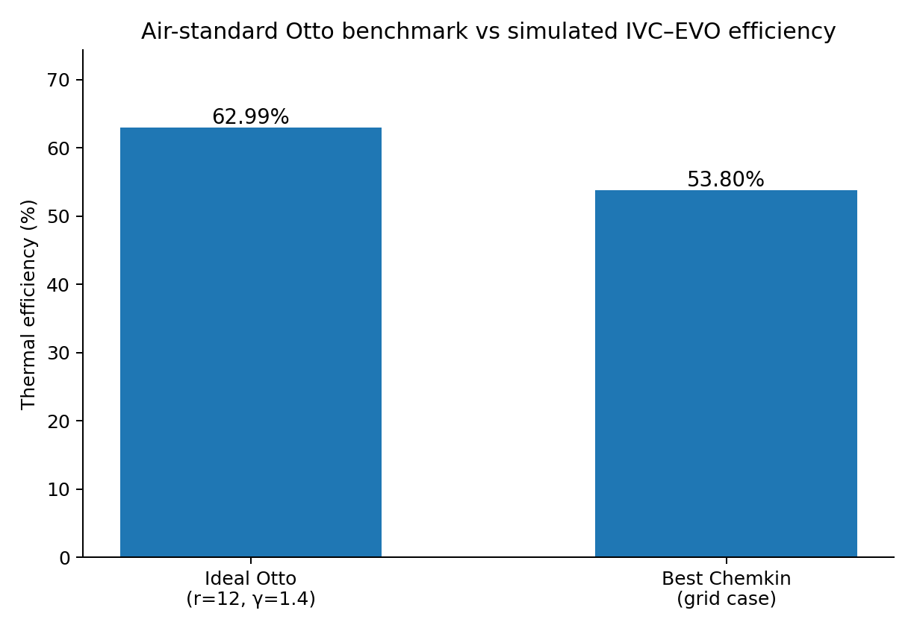

The difference is a **benchmark gap**, not a measured engine loss assigned to one mechanism. The ideal cycle assumes instantaneous heat addition and constant specific heats; Chemkin uses finite-duration prescribed combustion, reacting chemistry, and temperature- and composition-dependent properties. **Wall heat loss cannot explain this gap in the zero-wall-transfer baseline.** The constant $\gamma=1.4$ is an ideal-air assumption, not the reacting-gas value used by Chemkin.

## Gamma analysis

The separate [gamma archive](Group11_Gamma_Analysis/) post-processes exported temperature and composition states with the supplied NASA-7 thermodynamic coefficients. For usable ideal-gas mixture states, its script calculates mixture $C_p$, $C_v=C_p-R_u$, and $\gamma=C_p/C_v$. The [archive notes](Group11_Gamma_Analysis/README.txt) describe its data checks and outputs.

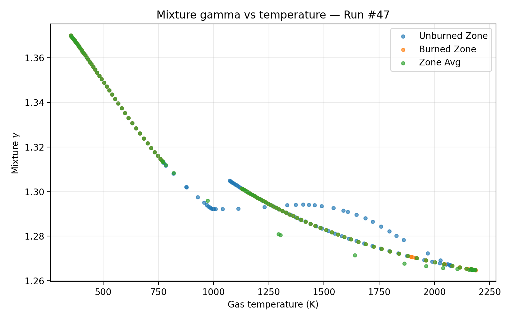

This is **archived secondary post-processing**, not a new simulation or a replacement for the report's constant-$\gamma$ Otto benchmark. A varying mixture $\gamma$ cannot simply be substituted into the constant-$\gamma$ Otto equation to calculate a variable-specific-heat cycle. The gamma script uses `/mnt/data` paths and an unavailable `group11_analysis.py` workbook-extraction helper, so a clean-checkout rerun is not currently supported. Its [state data](Group11_Gamma_Analysis/gamma_all_states.csv), [run summary](Group11_Gamma_Analysis/gamma_150_run_summary.csv), [quality flags](Group11_Gamma_Analysis/gamma_quality_issues.csv), and [script](Group11_Gamma_Analysis/build_gamma_analysis.py) are preserved.

## Reproduce and navigate

| Path | Contents |
| --- | --- |
| [`Group11_Report.docx`](Group11_Report.docx) | Final report with Chemkin evidence, figures, equations, and limitations. |
| [`presentations/Group11_Ethanol_Final_v11.pptx`](presentations/Group11_Ethanol_Final_v11.pptx) | Final 14-slide presentation. |
| [`chemkin/project/`](chemkin/project/) | `.ckprj`, `project.inp`, and adjacent chemistry files. |
| [`chemkin/mechanism/`](chemkin/mechanism/) | Supplied original reaction-mechanism package. |
| [`Book1.xlsm`](Book1.xlsm) | Original Chemkin workbook export; macros were not executed during repository preparation. |
| [`Group11_Final_Analysis/`](Group11_Final_Analysis/) | 150-case CSV, analysis code, QA, objective tables, and plots. |
| [`Group11_Gamma_Analysis/`](Group11_Gamma_Analysis/) | Secondary mixture-property calculation, CSVs, plots, and notes. |
| [`screenshots/`](screenshots/) | Genuine Chemkin setup, parameter-study, and result screenshots. |
| [`audit/`](audit/) | Historical inspection notes, which later project files may supersede. |
| Root ZIP files | Supplied source bundles retained for provenance. |

To regenerate **Python post-processing** from the committed 150-case CSV, use Python with NumPy and Matplotlib installed:

```bash
python3 Group11_Final_Analysis/analyze_group11.py
```

The script writes tables under `Group11_Final_Analysis/results/` and figures under `Group11_Final_Analysis/plots/`. It does **not** rerun Chemkin. Its code and command were inspected, but a fresh execution was not verified because the local Python environment lacked plotting dependencies. To inspect the proprietary model, open [`Group11_Ethanol_SI_Engine.ckprj`](chemkin/project/Group11_Ethanol_SI_Engine.ckprj) in Chemkin-Pro 2025 R2; paths from the original Windows package may need relinking.

## Limitations and contributors

- **Finite, boundary-limited grid:** The 150 cases do not establish a continuous or global optimum.
- **Zero wall heat transfer:** A calibrated heat-transfer model would represent real head, liner, and piston losses.
- **Prescribed combustion:** Start and duration are model inputs, not measured flame speed; a more predictive model could test ignition and turbulence effects.
- **Limited variables:** Load, mixture, and geometry were not swept.
- **No experimental validation:** No same-engine measurements were compared with the indicated outputs.
- **Solver evidence:** A complete per-case convergence-log set was not supplied; export checks cannot replace solver review.

| Member | Roll number | Primary contribution |
| --- | --- | --- |
| Raksha Gupta | 23ME10066 | Baseline simulation |
| Kanchan Potdar | 23ME10038 | 150-case parameter study |
| Saloni | 23ME10074 | Performance optimization and Otto comparison |
| Nagineni Lakshmipravallika | 23ME10053 | Python data analysis and visualization |
| Pranjali Khatua | 23ME10060 | Technical report and presentation |

No repository-wide license or independently verified redistribution terms for the supplied mechanism were found. Inclusion of those files preserves provenance but does not grant additional rights.
